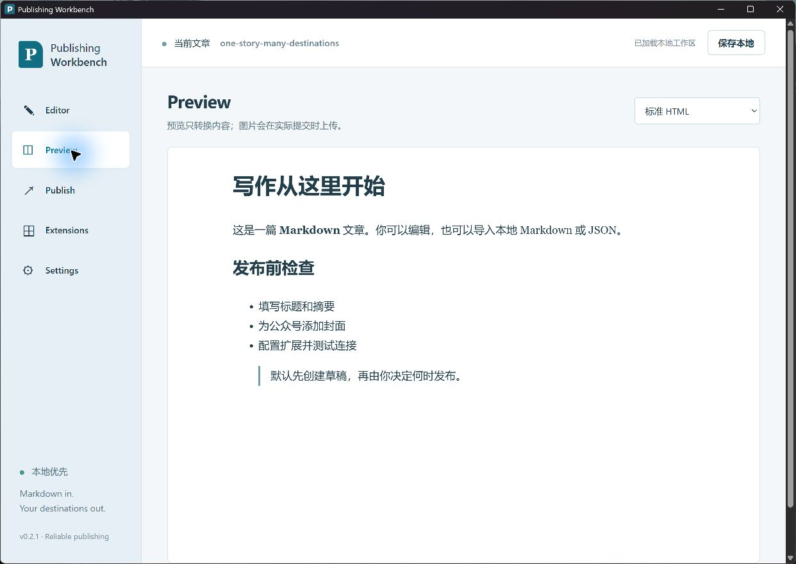
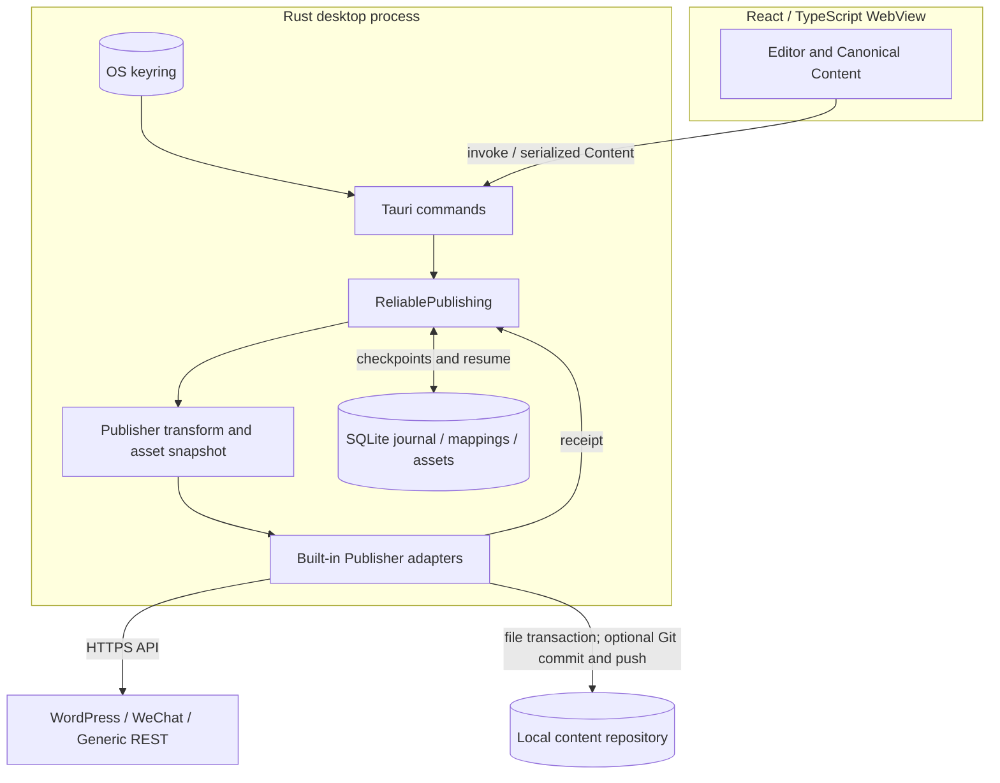

# Publishing Workbench

A local-first desktop workbench for editing Markdown/MDX and publishing through configured CMS or Git content adapters.

[简体中文](README.zh-CN.md) · [v0.2.1 prerelease](https://github.com/styayur/publishing-workbench/releases/tag/v0.2.1) · [Release notes](docs/release-v0.2.1.md)

**Alpha / MVP preview.** v0.2.1 is a published prerelease, not a stable release. The Tauri 2, Rust and React/TypeScript app keeps a SQLite publishing journal, remote mappings and asset receipts locally. It has no account system, cloud database or production deployment client. Later default-branch changes are not automatically included in the download.



Actual native desktop preview using built-in example data; this image does not prove a remote publish or site deployment. See [capture provenance](docs/README_SCREENSHOTS.md).

## Quick start

For Windows, download the portable EXE/ZIP from the [v0.2.1 prerelease](https://github.com/styayur/publishing-workbench/releases/tag/v0.2.1), verify the supplied checksums and extract before running. There is no installer, signature or automatic updater.

To develop from source, install Node.js 22+, stable Rust and Git. Windows also needs Microsoft C++ Build Tools and WebView2 Runtime. See [Tauri prerequisites](https://v2.tauri.app/start/prerequisites/) for platform dependencies; only Windows native execution has been verified for this preview.

```sh
git clone https://github.com/styayur/publishing-workbench.git
cd publishing-workbench
npm ci
npm run tauri -- dev
```

`npm run dev` serves the browser editor/preview demonstration. Configuration, SQLite and actual publishing run in the desktop Rust process.

1. Edit or import MD, MDX or canonical JSON. Keep the original workbench article or exported JSON for repeat publishing: IDs survive title/slug changes; a browser Markdown upload creates a new article each time.
2. Save an extension configuration and test its connection. Git content discovery suggests nearby compatible repositories but requires explicit saving.
3. Preview content. Local images become data URLs without uploading; MDX is stored as text and JSX is not executed in the preview.
4. Select a target in Publish. Draft is the default; direct publish/delete require GUI confirmation.
5. Use Retry / Resume in Publish History after checking the cause. Recovery uses the original content, asset snapshot and job ID; editing the current article does not alter the recovering job. Correcting credentials is allowed, but keep all other configuration unchanged when recovering that job.

Settings can specify the base directory for relative images; path imports otherwise use the source file's directory. Exporting JSON preserves article identity without rewriting the source file.

## Adapters and recovery

| Adapter                 | Supported operations                   | Boundary                                                                                           |
| ----------------------- | -------------------------------------- | -------------------------------------------------------------------------------------------------- |
| WordPress               | Draft, publish, update, assets         | Application Password; uncertain receipts need reconciliation; no strong concurrent-edit lock       |
| WeChat Official Account | Draft, update, assets                  | Account permissions/IP allowlist required; no mass sending, publish, delete or scheduling          |
| Generic REST            | Draft, publish, configured update      | `update_endpoint` is required for update; no generic asset upload protocol                         |
| Git Content             | Draft, publish, update, delete, assets | Commit/push off by default; validates ownership and working-tree conflicts; no reset or force push |

No adapter supports scheduling. The [Chinese reference](README.zh-CN.md#extension-api) preserves the full capability matrix and adapter options; [examples](examples) contain non-secret configuration.

Jobs record transform, asset/cover upload, remote create/update, mapping and completion. Retries retain successful receipts. A timeout or missing receipt can mean the remote write already happened: `needs_reconciliation` blocks blind creation. Arbitrary remote APIs cannot be guaranteed to execute exactly once. Git recovery uses persisted file transactions; REST retry safety depends on the configured server honoring its idempotency contract. See [reliability details](docs/reliability.md).

## Architecture

<!-- architecture:overview:start -->



<!-- architecture:overview:end -->

The desktop dispatch enters `ReliablePublishing::start`, which selects a Rust `Publisher` and performs transformation. The registry uses in-process traits, not dynamic plugin processes. SQLite holds jobs, checkpoints, mappings and asset receipts; OS keyring holds credentials. See [source evidence and diagram verification](docs/architecture/README.md).

Git Content writes through a guarded local transaction and can optionally commit/push. Any resulting site CI belongs to the destination repository. The workbench does not run Wrangler or bypass a site's publication gate; the [recorded local integration validation](docs/validation-v0.2.md) is distinct from a production deployment.

## Testing and platform support

Run from the repository root:

```sh
cargo fmt --manifest-path src-tauri/Cargo.toml --check
cargo clippy --manifest-path src-tauri/Cargo.toml --all-targets -- -D warnings
cargo test --locked --manifest-path src-tauri/Cargo.toml
npm test
npm run lint
npm run build
npm run tauri -- build
```

[Workbench checks](https://github.com/styayur/publishing-workbench/actions/workflows/ci.yml) runs these on Windows. The portable binary is emitted under `src-tauri/target/release/`; bundling is disabled. macOS/Linux source builds require their own platform validation. The separate architecture workflow checks source evidence and diagram rendering.

## Local data and limitations

SQLite, its WAL/lock files and asset cache live in app data under `dev.styayur.publishing-workbench`. `WORKBENCH_DATA_DIR` selects an isolated data directory for tests/portable setups; credentials remain in OS keyring. Back up data and snapshots together. Original v0.1 data is retained during import; unknown newer database versions are rejected.

Content and image snapshots on local disk are not additionally encrypted. Credentials are kept out of SQLite/Git, but users must still protect local data and review material before sharing reports. Requests allow HTTPS or loopback HTTP without following redirects. The Git adapter does not execute MDX, while a destination site's build may execute trusted MDX content.

Current limits include unsigned preview binaries, no auto-update, process/platform integration requiring independent validation, and no universal exactly-once remote operation guarantee. Recovery and destination-specific behavior are detailed in the [reference](README.zh-CN.md) and [reliability guide](docs/reliability.md).

## Contributing and next work

Use [Issues](https://github.com/styayur/publishing-workbench/issues) for redacted reproductions, including version, adapter and failed step. Run applicable checks for a PR and identify untested integrations. Keep databases, article snapshots and credentials out of commits. [Release notes](docs/release-v0.2.1.md) and the reliability guide distinguish implemented behavior from remaining work; this preview makes no delivery-date promise.

## License

First-party application code, built-in adapters, tests and code examples use [AGPL-3.0-only](LICENSE). README, documentation and original example prose use [CC BY 4.0](LICENSE-CONTENT). Third-party components keep their own terms in [THIRD_PARTY.md](THIRD_PARTY.md) and [NOTICE](NOTICE). Digital Garden Engine is an external compatibility target; its code is not copied or relicensed. See the [portfolio license policy](https://github.com/styayur/styayur/blob/main/LICENSE_POLICY.md).
